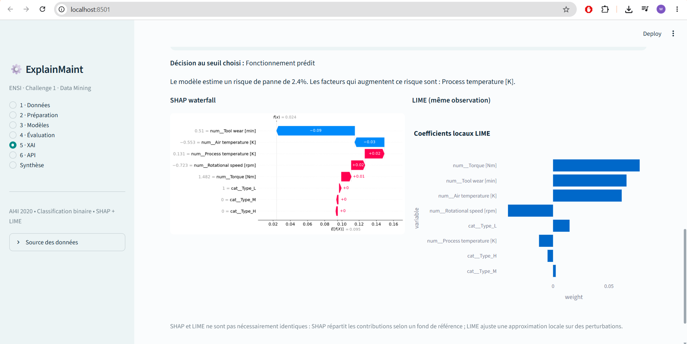

# ExplainMaint — Maintenance prédictive explicable

**ENSI · Data Mining · Challenge 1 · cas 15.** Application Streamlit et FastAPI de classification binaire des pannes, comparaison de cinq modèles et explications SHAP/LIME. Voir le [sujet officiel](assets/sujet_officiel.pdf) et la [matrice de conformité](docs/AUDIT_MODULES.md).

**Livrable mesuré à remettre : [one_pager_final.pdf](one_pager_final.pdf).** Ce PDF et les captures d’origine sont conservés à l’identique. Les validations supplémentaires restent distinctes ; aucun score n’est inventé. L’état des tests et de la publication figure dans la [checklist finale](CHECKLIST_DEPOT.md).

## Six modules

| Module | Fonctionnalités |
| --- | --- |
| Données | UCI, cache, CSV, statistiques, distributions, corrélations et proportions |
| Préparation | Cible/classe positive/prédicteurs, imputation, encodage, standardisation, split stratifié |
| Modèles | Régression logistique, arbre, KNN, Random Forest, XGBoost ; paramètres et optimisation optionnelle |
| Évaluation | AUC-ROC, AP, précision, rappel, F1, ROC/PR, confusion et seuil |
| XAI | Importances natives/permutation, SHAP global/local, LIME du même individu et synthèse |
| API | Activation du pipeline, appels HTTP FastAPI, santé, modèle, explications et OpenAPI |

La Synthèse ajoute la génération d’un PDF avec les mesures courantes.

## Lancement local — Python 3.11

```powershell
py -3.11 -m venv .venv
.\.venv\Scripts\python.exe -m pip install -r requirements.txt
# Terminal 1, dans le dossier du projet
.\.venv\Scripts\python.exe -m uvicorn api:app --host 127.0.0.1 --port 8000
# Terminal 2, dans le même dossier
.\.venv\Scripts\python.exe -m streamlit run app.py
```

Linux/macOS : `python3.11 -m venv .venv`, `source .venv/bin/activate`, puis utiliser `python -m pip`, `python -m uvicorn` et `python -m streamlit`.

Interface locale : <http://localhost:8501>. API interactive : <http://localhost:8000/docs>. Le premier chargement télécharge UCI ; les suivants utilisent `data/ai4i2020.csv`. Aucun modèle préentraîné n’est distribué : **Entraîner** dans Modèles, choisir XGBoost dans XAI, puis **Activer ce modèle dans l’API FastAPI**. Streamlit et FastAPI partagent `artifacts/active_bundle.joblib`, exclu du dépôt.

## Docker et Hugging Face Spaces

```bash
docker build -t explainmaint .
docker run --rm -p 7860:7860 explainmaint
```

Le port public **7860** dessert Streamlit à `/` et FastAPI à `/api/` via Nginx. Swagger : `/api/docs` ; schéma : `/api/openapi.json`. Les WebSockets passent par le même proxy. Le conteneur utilise un utilisateur non privilégié, surveille ses trois processus et possède un contrôle de santé.

Les métadonnées du Space sont déjà dans ce README. Le [guide de déploiement](README_HUGGINGFACE.md) explique la préparation du dossier, l’authentification et la publication.

```bash
python scripts/prepare_space.py
python scripts/verify_deployment.py http://localhost:7860
# Après entraînement et activation de XGBoost dans l’interface :
python scripts/verify_deployment.py http://localhost:7860 --require-model
```

Le premier contrôle valide les services ; le second exige un modèle actif et calcule SHAP/LIME. Un démarrage Docker seul ne prouve pas l’exécution du parcours ML.

Configuration : `EXPLAINMAINT_API_URL` (défaut `http://127.0.0.1:8000`), `EXPLAINMAINT_API_ROOT_PATH` (`/api` dans Docker), `MODEL_PATH` (artefact actif). Si une autre session remplace le modèle, son identifiant d’activation permet de détecter le conflit et de revenir au calcul local signalé. Le Space reste un démonstrateur partagé, sans stockage permanent par utilisateur. Sur stockage éphémère, réentraîner et réactiver après reconstruction.

## Données et méthode

Source : [AI4I 2020, UCI ID 601](https://archive.ics.uci.edu/dataset/601/ai4i+2020+predictive+maintenance+dataset), [DOI 10.24432/C5HS5C](https://doi.org/10.24432/C5HS5C), licence **CC BY 4.0**. Jeu **synthétique** de 10 000 observations. Six prédicteurs : type, températures air/process, vitesse de rotation, couple et usure outil. Cible : `Machine failure`, classe positive 1.

`UDI`, `UID`, `Product ID`, `TWF`, `HDF`, `PWF`, `OSF`, `RNF` sont interdits comme prédicteurs de cette cible, y compris pour un CSV AI4I. Les modes de panne révéleraient le résultat. Un CSV personnalisé exige aussi l’examen des variables connues après l’événement.

Split stratifié, graine 42, test 25 % par défaut. Imputation médiane/modale, one-hot et StandardScaler sont ajustés **sur train uniquement**. L’optimisation utilise `RandomizedSearchCV`, 3 plis et 4 tirages par modèle, sur l’entraînement.

AP désigne `average_precision_score`, résumé précision-rappel. En classe rare, lire AP, rappel et précision ensemble. La Synthèse suggère le meilleur AP du test : choix descriptif avec risque de biais de sélection, à confirmer sur une validation indépendante.

SHAP explique la probabilité de classe 1 par permutations ; LIME ajuste une approximation locale. Les deux utilisent les variables transformées : certaines perturbations one-hot peuvent être irréalistes. Leurs explications ne prouvent pas une causalité. Aucune étude de calibration, validation chronologique ou validation industrielle n’est revendiquée.

## Résultats et preuves conservés

Le [PDF final fourni](one_pager_final.pdf) et la capture de comparaison donnent pour **XGBoost, seuil 0,50** :

| AUC-ROC | AP | Précision | Rappel | F1 |
| ---: | ---: | ---: | ---: | ---: |
| 0,9766 | 0,7764 | 0,5113 | 0,8000 | 0,6239 |

Ces chiffres proviennent de l’exécution historique fournie. Les versions initiales n’étaient pas verrouillées ; une nouvelle exécution peut différer. Les nouvelles mesures conservent leurs versions et leur protocole dans `results/validation_2026-10-13/` lorsqu’elles sont exécutées.

Les empreintes des originaux sont dans [original_artifacts.sha256.json](docs/original_artifacts.sha256.json). `one_pager_modele.pdf` reste le canevas non mesuré ; **il ne remplace pas le PDF final**.

| Capture locale fournie | Contenu visible |
| --- | --- |
| [01 — Données](assets/captures/01_donnees.png) | Source UCI et aperçu |
| [02 — Comparaison](assets/captures/02_comparaison.png) | Scores des cinq modèles |
| [03 — Évaluation](assets/captures/03_courbes.png) | Courbes ROC/PR |
| [04 — Onglet XAI](assets/captures/04_shap_global.png) | Importance native ; le beeswarm n’est pas visible |
| [05 — SHAP et LIME](assets/captures/05_shap_lime_local.png) | Même observation |
| [06 — API](assets/captures/06_api_modele_actif.png) | API locale connectée avec XGBoost |



Ces captures attestent d’une exécution locale historique, sans prouver une publication.

## Validation du 13 octobre 2026

**49 tests réussis** (ML, SHAP/LIME, FastAPI et parcours Streamlit), **11 cellules du notebook exécutées sans erreur**. Les 25 métriques des cinq modèles reproduisent les chiffres historiques aux quatre décimales. Preuves : [tests](results/validation_2026-10-13/pytest_final.xml), [métriques recalculées](results/validation_2026-10-13/comparaison_modeles.csv), [protocole et versions](results/validation_2026-10-13/execution_metadata.json), [beeswarm SHAP calculé](results/validation_2026-10-13/shap_global_beeswarm.png), [dépendance SHAP](results/validation_2026-10-13/shap_dependance.png).

`requirements.txt` applique les versions validées de `requirements-lock.txt` comme contraintes. Ce verrou contient aussi les dépendances de développement ; l’installation de production n’installe que les paquets requis par l’application. Les dépendances propres à Linux sont résolues lors du build Docker.

## Tests et notebook

```bash
python -m pip install -r requirements-dev.txt
python -m pytest -q
python scripts/check_delivery.py
python scripts/validate_notebook.py
python scripts/validate_notebook.py --execute
```

Les tests emploient des données générées pour vérifier le logiciel ; leurs scores ne sont pas des performances AI4I. Ils couvrent cinq modèles, optimisation XGBoost, additivité SHAP, LIME, imputation, fuite de cible, persistance et FastAPI (404/409/422, proxy).

Le [notebook](notebooks/analyse_ai4i.ipynb) utilise `core.py` et les données UCI. Ses sorties sont sauvegardées après exécution complète réussie. Le test API utilise un artefact temporaire. Les GitHub Actions vérifieront tests et Docker après publication ; leur présence ne signifie pas qu’elles ont déjà réussi.

## Livrables

```text
app.py / api.py / core.py / report.py  Interface, API, ML/XAI et PDF
notebooks/analyse_ai4i.ipynb          Analyse reproductible
one_pager_final.pdf                  Synthèse historique mesurée
assets/                             Sujet et six captures
docs/                               Audit, empreintes et validation
tests/                              Tests ML/XAI/API/interface
deployment/                         Proxy et santé Docker
scripts/                            Validation et préparation de publication
requirements*.txt                   Dépendances
Dockerfile / start.sh                Space Docker
.github/workflows/checks.yml         Vérifications automatisées
```

**Liens publics : non publiés à ce stade.** Ils seront ajoutés après autorisation, publication effective et vérification. Voir [CHECKLIST_DEPOT.md](CHECKLIST_DEPOT.md).
